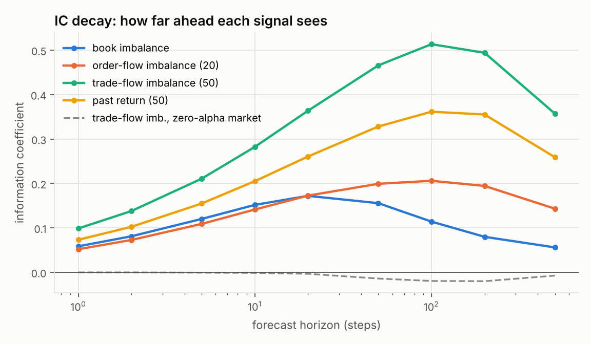
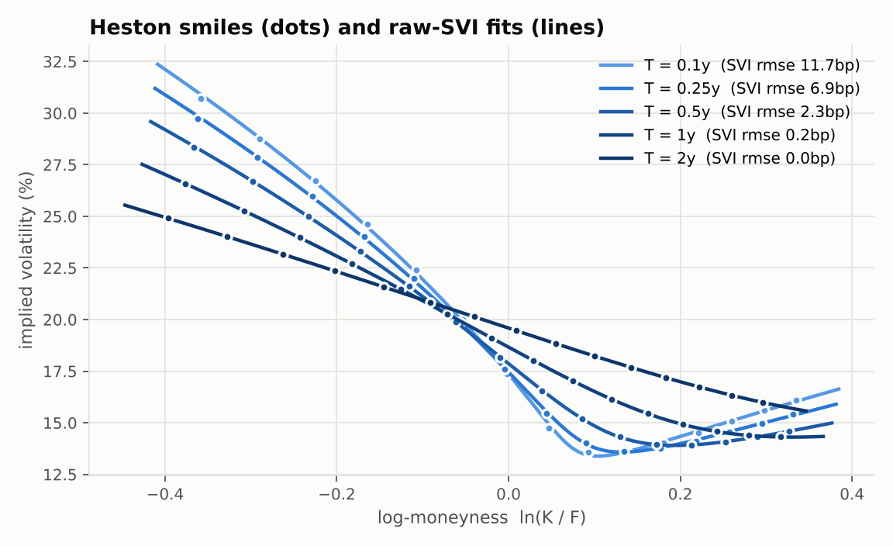
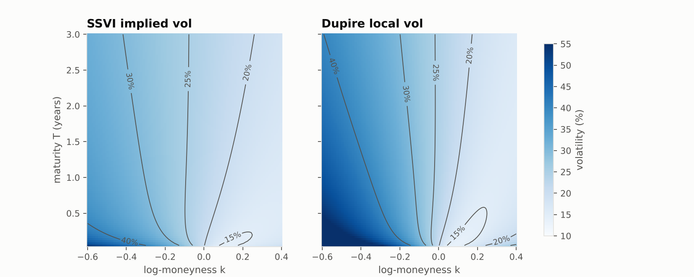
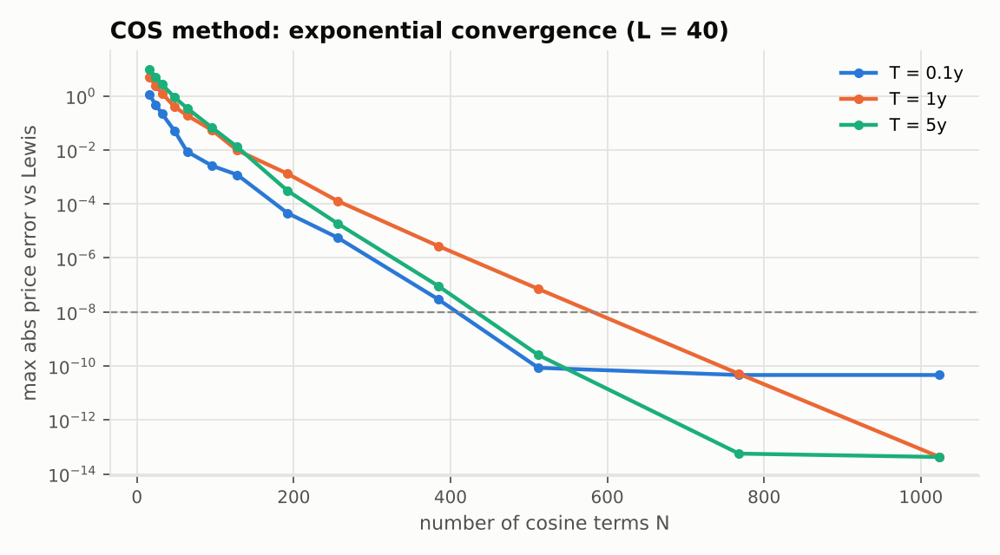
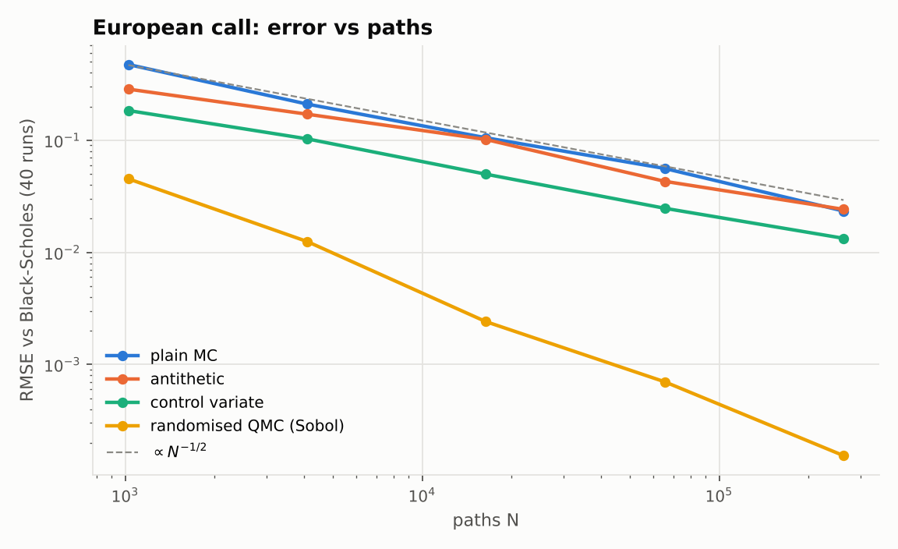
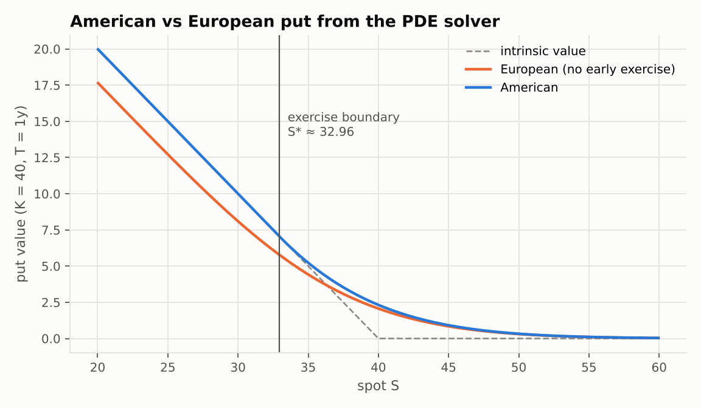
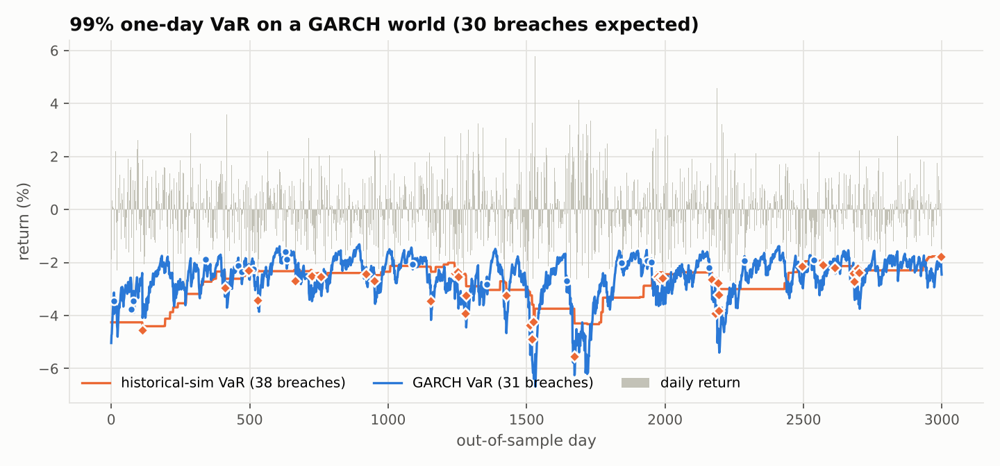
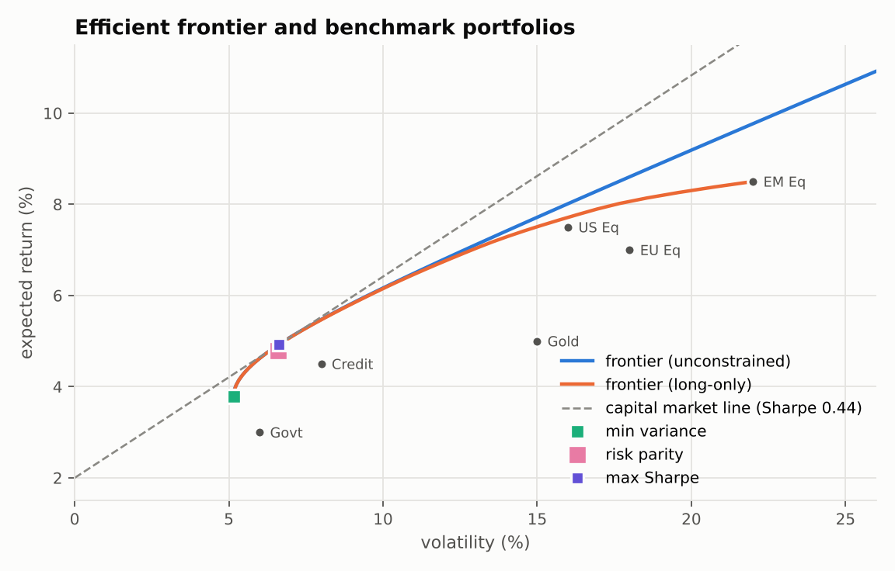

# quantforge

**Derivatives pricing, volatility surfaces and quantitative risk in Python,
with every model checked against a closed form, a published benchmark, or an
independent numerical method.**

`quantforge` is a from-scratch quantitative finance library (NumPy + SciPy only)
that covers the core toolkit of a sell-side quant / risk desk:

| Area | What is implemented |
|---|---|
| **Black-Scholes** | Prices and 9 analytic Greeks (incl. vanna, volga, charm), Black-76, robust vectorised implied volatility |
| **Fourier pricing** | COS method (Fang-Oosterlee) and Lewis (2001) single-integral formula for any characteristic function |
| **Heston** | Branch-cut-safe characteristic function, vega-weighted calibration, Andersen QE Monte Carlo |
| **Vol surfaces** | Raw SVI fitting, SSVI, Durrleman butterfly and calendar arbitrage checks, Dupire local vol, local-vol MC |
| **PDE** | Crank-Nicolson with Rannacher smoothing; American exercise by the penalty method; knock-out barriers |
| **Lattices** | CRR and Leisen-Reimer binomial trees: European, American, Bermudan |
| **Monte Carlo** | Antithetics, optimal control variates, randomised QMC (Sobol), Brownian-bridge barriers, Longstaff-Schwartz |
| **Rates** | Par-curve bootstrapping, Nelson-Siegel-Svensson, Vasicek and CIR (closed forms, Jamshidian bond options, exact simulation) |
| **Risk** | Historical / normal / Student-t / Cornish-Fisher / MC VaR and ES; Kupiec and Christoffersen backtests |
| **Econometrics** | GARCH(1,1) quasi-MLE with standard errors and variance forecasts |
| **Portfolio** | Min-variance, max-Sharpe, efficient frontier (with or without a long-only constraint), risk parity, Ledoit-Wolf shrinkage (matches scikit-learn to 1e-12) |
| **Alpha research** | Order-book imbalance, microprice, order-flow imbalance, trade-flow imbalance; IC decay with Newey-West inference; purged walk-forward ridge; cost-aware backtest; Probabilistic and Deflated Sharpe; Avellaneda-Stoikov market making with alpha skew; Binance data loader |

```
90 tests · ~45 s · deterministic seeds · Monte Carlo checks asserted within 4 standard errors
```

---

## Validation: numbers against references

Reproduce this table with `python examples/showcase.py`. `±` is a 95% confidence half-width.

| Problem | quantforge | Reference | Source / note |
|---|---|---|---|
| Black-Scholes ATM call (S=K=100, r=5%, σ=20%) | 10.450584 | 10.450584 | Hull |
| Implied vol round-trip, 720 quotes (σ 5%–150%, T 0.01–5y) | max error 8.6e-13 (vega > 1e-2) | 0 | safeguarded Newton |
| Heston ATM call, COS method | 5.785155434 | 5.785155450 | Fang & Oosterlee (2008) |
| Heston ATM call, Lewis quadrature | 5.785155434 | 5.785155450 | Fang & Oosterlee (2008) |
| Heston ATM call, QE Monte Carlo (400k paths) | 5.8008 ± 0.0250 | 5.785155450 | Andersen (2008) |
| Heston calibration, 75 quotes | IV RMSE 1.9e-08 in 0.9 s | exact recovery | 9 function evaluations |
| Local-vol MC reprices SSVI vanillas, 5 strikes | max abs z-score 0.85 | N(0,1) noise | Dupire / Gatheral |
| Arithmetic Asian, geometric control variate | 5.8535 ± 0.0010 | plain MC 5.842 ± 0.035 | variance cut ~1,300x |
| Down-and-out call: PDE | 8.13879 | 8.13881 | Reiner-Rubinstein closed form |
| Down-and-out call: MC + Brownian bridge (50 steps) | 8.1506 ± 0.0728 | 8.13881 | naive MC: 8.960 (biased) |
| American put S=36, K=40: PDE (CN + penalty) | 4.4866 | LR tree 4.4864 | independent methods |
| Bermudan put, 50 dates: Longstaff-Schwartz | 4.4809 ± 0.0084 | 4.478 (CRR lattice 4.4779) | Longstaff & Schwartz (2001), Table 1 |
| VaR backtest rejection rate, 40 GARCH histories | GARCH 10% / historical-sim 90% | 5% for a correct model | Christoffersen conditional coverage |

Notes worth reading:

* **Heston benchmark.** COS and Lewis agree with each other to 1e-10, and both
  differ from the 9-digit value published by Fang & Oosterlee by 1.6e-8.
* **The 4.478 in Longstaff-Schwartz's Table 1 is a Bermudan value** (50
  exercise dates). The continuously exercisable American put is 4.4866, and the
  PDE, the Leisen-Reimer tree and the CRR tree all agree on it. A CRR lattice
  restricted to the same 50 dates gives 4.4779, which validates LSM like for like.
* **GARCH VaR is rejected 10% of the time, not 5%.** The model is re-estimated
  on 1,500 days, and parameter uncertainty inflates the breach count slightly.
  This is reported as measured rather than tuned away.

---

## Alpha research: signals, honest evaluation, market making

`quantforge.alpha` is a short-horizon alpha pipeline of the kind used at
market-making and HFT firms. The full guide, from zero, is
**[docs/ALPHA.md](docs/ALPHA.md)**, and the generated report is in
[docs/ALPHA_RESULTS.md](docs/ALPHA_RESULTS.md).

These results come from a **simulated** order book with a planted alpha.
That is how the pipeline is validated: the true answer is known by
construction, and a zero-alpha market serves as the control. The same script
runs unchanged on Binance `bookTicker` and `aggTrades` files.

| finding | number |
|---|---|
| Naive OLS on overlapping returns "finds" alpha in a zero-alpha market | 34 / 40 runs |
| Newey-West inference, same markets | 4 / 40 runs |
| Combined ridge alpha, out-of-sample (h = 10 steps) | R² 0.103, IC 0.32 |
| Same pipeline on the zero-alpha market | R² −0.0007 |
| Break-even taker fee of that alpha | ≈ 1.0 bp, so it loses money at a 5 bp taker fee |
| Market maker vs informed flow: symmetric → Avellaneda-Stoikov → + alpha skew | Sharpe 0.78 → 5.61 → 7.13 |



The alpha enters the trading model through the reservation price:

$$r_t = s_t + \hat\alpha_t\,\frac{1-e^{-\theta\tau}}{\theta} - q_t\,\gamma\sigma^2\tau,\qquad \delta^a+\delta^b=\gamma\sigma^2\tau+\tfrac{2}{\gamma}\ln\!\left(1+\tfrac{\gamma}{k}\right)$$

A no-look-ahead test, which scrambles the future and checks that past signals
are unchanged, caught a real leakage bug during development. It is described
in the guide.

---

## Highlights

### Volatility surface: SVI fits Heston, Dupire turns it into local vol



SVI fit error falls from ~12bp at T = 0.1y to ~0bp at 2 years. This is expected,
because SVI is the large-maturity limit of Heston (Gatheral & Jacquier, 2011).



Local volatility comes from Gatheral's total-variance form of Dupire:

$$\sigma_{loc}^2(k,T)=\frac{\partial_T w}{\left(1-\frac{k\,\partial_k w}{2w}\right)^2-\frac{(\partial_k w)^2}{4}\left(\frac1w+\frac14\right)+\frac{\partial_{kk}w}{2}}$$

The denominator is Durrleman's butterfly function, so the same code doubles as
a static-arbitrage detector. The test suite confirms it flags Axel Vogt's
well-known arbitrageable SVI slice. In the end-to-end test, vanillas simulated
under the local-vol diffusion reproduce the input SSVI surface to within
Monte Carlo noise.

### Fourier pricing: exponential convergence



A whole strike strip is priced from a single evaluation of the characteristic
function. The default truncation is deliberately wide (L = 40 standard
deviations). The textbook choice of L = 12 leaves errors of about 1e-3 when the
Feller condition is badly violated and the log-price density has fat
exponential tails. The tests found this, and the docstring documents it.

### Monte Carlo: variance reduction that is measured, not claimed



Randomised QMC reports its standard error from independent scrambles, because
the i.i.d. formula is invalid for low-discrepancy points. Antithetic pairs are
averaged before the variance is taken, so their correlation is accounted for.

### Early exercise



The penalty method (Forsyth & Vetzal, 2002) enforces `V ≥ payoff` by iterating
banded linear solves to a fixed active set: about 1.5 iterations per time step
and no PSOR sweeps.

### Risk: a backtest that has statistical power



On returns with volatility clustering, a 250-day historical-simulation VaR has
roughly the right number of breaches, but they arrive in clusters.
Christoffersen's independence test catches this, and the model fails 90% of
simulated histories. The GARCH VaR moves with volatility and fails only 10%.

### Portfolio construction



---

## Quick start

```bash
git clone <this repo> && cd quantforge
python -m venv .venv && source .venv/bin/activate
pip install -e ".[dev]"
pytest                       # 90 tests, ~45 s
python examples/showcase.py  # regenerates docs/figures and docs/RESULTS.md (~45 s)
python examples/alpha_research.py  # alpha study -> docs/ALPHA_RESULTS.md (~20 s)
```

```python
import numpy as np
from quantforge import blackscholes as bs
from quantforge.heston import HestonParams, heston_price, calibrate_heston
from quantforge.implied_vol import implied_vol
from quantforge.pde import bs_pde
from quantforge.montecarlo import longstaff_schwartz

# Greeks
bs.greeks(S=100, K=105, T=0.5, r=0.04, sigma=0.22, q=0.01, is_call=True)["vanna"]

# Heston strip -> implied vols
p = HestonParams(v0=0.04, kappa=2.0, theta=0.05, sigma=0.6, rho=-0.7)
K = np.linspace(70, 140, 15)
prices = heston_price(p, S=100, K=K, T=0.5, r=0.03, q=0.0)
vols = implied_vol(prices, 100, K, 0.5, 0.03)

# American put: PDE vs least-squares Monte Carlo
bs_pde(36, 40, 1.0, 0.06, 0.2, is_call=False, american=True).price      # 4.4866
longstaff_schwartz(36, 40, 1.0, 0.06, 0.2, n_exercise=50, seed=1).price  # ~4.478 (Bermudan)
```

---

## Design notes

* **Vectorised end to end.** Implied vol, Greeks, COS and the Monte Carlo
  engines operate on arrays. The only Python loops are over time steps and
  maturities.
* **Implied vol.** Quotes are mapped to their out-of-the-money equivalent via
  put-call parity, then solved by a per-element bracketed Newton iteration that
  falls back to bisection. The method is globally convergent, accurate to machine
  precision where vega is meaningful, and returns NaN for arbitrage violations.
* **Heston characteristic function.** Uses the Albrecher et al. (2007) "little
  trap" form, which avoids the complex-log branch cut of the original that
  breaks long-dated prices.
* **Calibration.** Price residuals are divided by Black-Scholes vega, a
  first-order IV error, so the fit is effectively in vol space without an IV
  inversion inside the optimiser. Trust-region reflective least squares
  handles the bounds.
* **SVI fit.** The fit is parameterised by `(w_min, b, ρ, m, s)` with
  `w_min ≥ 0`, which makes non-negative total variance a simple box constraint.
  Roger Lee's wing bound `b(1+|ρ|) ≤ 2` is enforced as a penalty.
* **Longstaff-Schwartz.** Regressions use weighted Laguerre polynomials on
  in-the-money paths. By default the exercise policy is fitted on one path set
  and evaluated on an independent one. This gives a true lower bound without
  in-sample foresight bias.
* **GARCH likelihood.** The variance recursion is an IIR filter evaluated with
  `scipy.signal.lfilter`. Returns are standardised for conditioning, and the
  log-likelihood is corrected for the Jacobian of the rescaling.

## Repository layout

```
src/quantforge/
  blackscholes.py  implied_vol.py  fourier.py  heston.py  svi.py  localvol.py
  pde.py  trees.py  exotics.py  montecarlo.py  rates.py  risk.py  garch.py  portfolio.py
  alpha/           signals.py  evaluation.py  market_making.py  simulate.py  data.py
tests/            90 tests: closed forms, published benchmarks, cross-method agreement
examples/showcase.py        regenerates the pricing/risk figures and results table
examples/alpha_research.py  end-to-end alpha study (simulated by default, or Binance files)
docs/             figures and RESULTS.md
```

## References

Albrecher, Mayer, Schoutens & Tistaert (2007), *The little Heston trap* ·
Andersen (2008), *Simple and efficient simulation of the Heston model* ·
Christoffersen (1998), *Evaluating interval forecasts* ·
Dupire (1994), *Pricing with a smile* ·
Fang & Oosterlee (2008), *A novel pricing method for European options based on Fourier-cosine series expansions* ·
Forsyth & Vetzal (2002), *Quadratic convergence for valuing American options using a penalty method* ·
Gatheral (2006), *The Volatility Surface* ·
Gatheral & Jacquier (2014), *Arbitrage-free SVI volatility surfaces* ·
Heston (1993) · Jamshidian (1989) · Kemna & Vorst (1990) · Kupiec (1995) ·
Ledoit & Wolf (2004), *A well-conditioned estimator for large-dimensional covariance matrices* ·
Leisen & Reimer (1996) · Lewis (2001), *A simple option formula for general jump-diffusion and other exponential Lévy processes* ·
Longstaff & Schwartz (2001), *Valuing American options by simulation* ·
Spinu (2013), *An algorithm for computing risk parity weights*

## License

MIT
