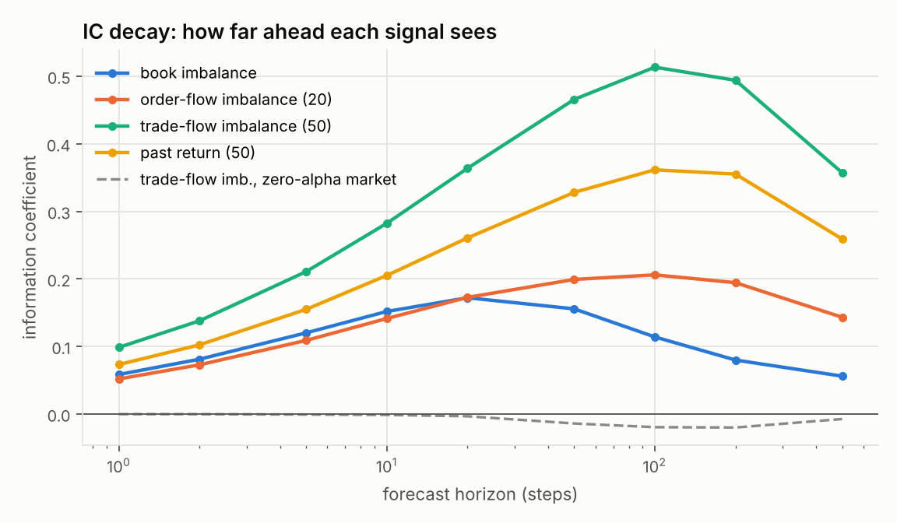
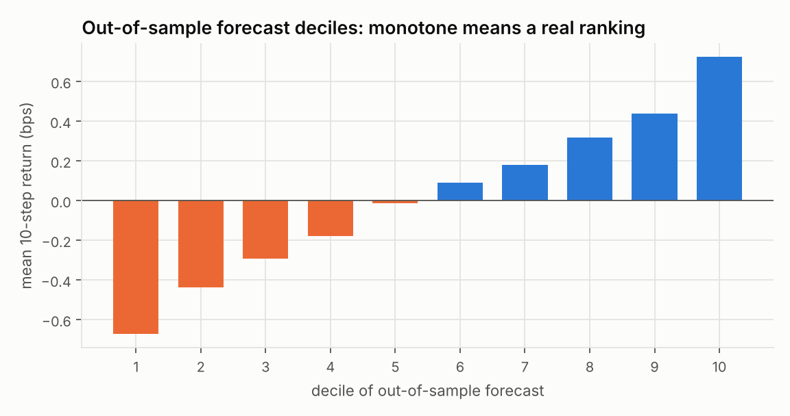
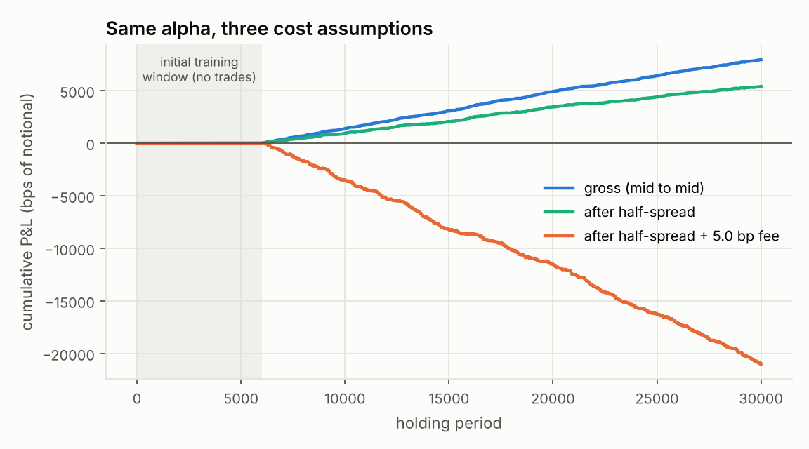
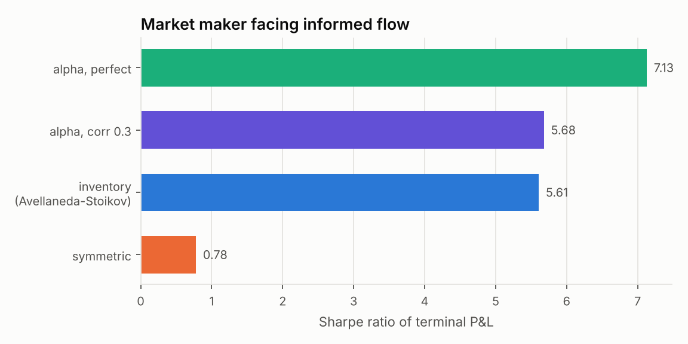

# Alpha research, from zero

This guide explains `quantforge.alpha`: what an alpha is, the formulas behind
the classic high-frequency signals, how to tell whether a signal is real, and
how a market maker turns a weak signal into money. Every formula here is
implemented in `src/quantforge/alpha/` and checked in `tests/test_alpha.py`.
All the results come from `python examples/alpha_research.py` and are in
[`ALPHA_RESULTS.md`](ALPHA_RESULTS.md).

> **About the data.** The numbers in this guide come from a *simulated* order
> book into which a known alpha was planted on purpose. That is how the
> pipeline is validated: there, unlike in a real market, the right answer is
> known. The planted alpha is deliberately strong so the effects are easy to
> see. On real markets these signals have much smaller ICs. Section 9 shows
> how to run the same pipeline on real Binance data.

---

## 1. What "alpha" means

Let `r_{t,h}` be the return from now (`t`) to `h` steps ahead, and let `F_t`
be everything known at time `t`. An **alpha** is a forecast of that return:

```
alpha_t(h) = E[ r_{t,h} | F_t ]
```

You never observe the true conditional expectation. You build a signal `x_t`
and ask how well it ranks future returns. The standard score is the
**information coefficient**:

```
IC(h) = corr( x_t , r_{t,h} )
```

An IC of 0.05 sounds tiny, but the **fundamental law of active management**
(Grinold) explains why firms care about it:

```
information ratio  ≈  IC × sqrt(breadth)
```

Breadth is the number of independent bets per year. A market maker making
millions of small, nearly independent decisions can turn a 0.02 IC into a
very high Sharpe ratio. A weekly stock picker with the same IC cannot. That
is why high-frequency firms exist, and why they care about tiny, short-lived
signals.

---

## 2. The signals and why they work

The limit order book at any moment: the best bid `Pb` with `Qb` shares
waiting, and the best ask `Pa` with `Qa` shares waiting. The mid is
`(Pb + Pa)/2`.

### 2.1 Order-book imbalance

```
I = (Qb - Qa) / (Qb + Qa)          ranges over (-1, 1)
```

**Intuition.** Suppose 900 lots are bid and 100 are offered. The ask queue
will very likely be eaten first, so the next mid move is more likely up. This
is the single most important short-horizon signal in electronic markets.

*Worked example:* `Qb = 900, Qa = 100` gives `I = 800/1000 = 0.8`.

### 2.2 Microprice

```
P_micro = (Pa·Qb + Pb·Qa) / (Qb + Qa)
```

The microprice is the mid pulled toward the side that is about to give way.
With `Pb = 99.99, Pa = 100.01, Qb = 900, Qa = 100`:
`P_micro = (100.01·900 + 99.99·100)/1000 = 100.008`, above the mid of `100.00`.

It is the same information as `I`:
`P_micro − mid = I · (spread/2)`. With a constant one-tick spread the two
signals are perfectly collinear. That is why the report uses only `I`.
Stoikov (2018) derives a refined microprice that is a martingale.

### 2.3 Order-flow imbalance (Cont, Kukanov & Stoikov 2014)

Imbalance is a *level*. OFI measures the *flow*: how much buying interest
arrived, net of selling interest, between two book updates.

```
e_n = Qb_n·1{Pb_n ≥ Pb_{n-1}} − Qb_{n-1}·1{Pb_n ≤ Pb_{n-1}}
    − Qa_n·1{Pa_n ≤ Pa_{n-1}} + Qa_{n-1}·1{Pa_n ≥ Pa_{n-1}}
OFI_t(w) = Σ e_n over the last w updates
```

Read it case by case:
- **Bid price unchanged:** the term is `Qb_n − Qb_{n−1}`, the bid queue's change.
- **Bid price ticks up:** a whole new queue `Qb_n` of demand appeared.
- **Bid price ticks down:** the old queue `Qb_{n−1}` vanished, which is demand lost.
- The ask terms mirror this with the opposite sign.

`test_order_flow_imbalance_hand_computed` checks each of these cases with
numbers you can verify by hand.

### 2.4 Trade-flow imbalance

```
TFI_t(w) = (buy volume − sell volume) / (buy volume + sell volume)    over last w steps
```

A trade is a *buy* if the aggressor lifted the ask. Persistent one-sided
aggression is the footprint of an informed trader or a large parent order
being worked through the market, and it tends to continue.

### 2.5 Past return (momentum / reversal)

```
R_t(w) = (mid_t − mid_{t−w}) / mid_{t−w}      in basis points
```

A positive coefficient means momentum; a negative one means reversal. Always
measure it **mid to mid**. On trade prices, bid-ask bounce (trades alternating
between bid and ask) produces fake reversal "alpha".

---

## 3. Measuring a signal honestly

### 3.1 IC decay

Compute the IC for many horizons `h`. The curve shows how long the
information lasts, which tells you how fast you have to act. In the report,
book imbalance peaks at about 20 steps and fades. Trade-flow imbalance
persists longer because it proxies a slow-moving informed state.



The grey dashed line is the same signal on a market with **zero** alpha. It
is flat at zero, as it must be.

### 3.2 The overlapping-returns trap: Newey-West

If you measure 50-step returns at every step, consecutive observations share
49 of their 50 price moves. They are not independent. Ordinary least squares
treats them as independent, so its standard errors are far too small and
every t-stat is inflated.

**Newey-West** standard errors account for that autocorrelation:

```
S   = Γ_0 + Σ_{l=1..L} (1 − l/(L+1)) (Γ_l + Γ_lᵀ),   Γ_l = Σ_t g_t g_{t−l}ᵀ,  g_t = u_t x_t
Var = (XᵀX)⁻¹ S (XᵀX)⁻¹                                  with L = h
```

From the report, at `h = 50`:

| signal | naive t | Newey-West t |
|---|---|---|
| book imbalance | 86.3 | 16.9 |
| trade-flow imbalance | 288.1 | 48.7 |

A **controlled experiment** in the tests shows why this matters. On 40
simulated markets with *no alpha at all*, the naive t-test "found" a
significant signal **34 times out of 40**. Newey-West did so 4 times out of
40, close to the 5% you would expect from luck. Our implementation matches
`statsmodels` to 1e-8.

### 3.3 Walk-forward fitting with purging and an embargo

Combining signals means fitting weights, and fitting means you can overfit or
leak future information.

- **Walk-forward:** split time into blocks. Fit only on data *before* each
  test block, predict the block, then move on.
- **Purge and embargo:** a training row at time `t` has a label that looks
  `h` steps ahead. If `t` is within `h` steps of the test block, the label
  contains test-period prices. That is leakage, so those rows are dropped.
  The code refuses an embargo shorter than the horizon.
- **Standardisation:** features are standardised with *training* statistics
  only.

### 3.4 No look-ahead, enforced

`test_signals_never_look_ahead` scrambles all data after a time `t0` and
asserts that every signal value up to `t0` is unchanged. **This test caught a
real bug.** The first version of OFI was normalised by the full-sample
average depth, which quietly used future order books. It now uses a causal
EWMA of depth.

---

## 4. Combining signals: ridge regression

With standardised signals `Z` (n×p) and forward returns `y`:

```
w = (ZᵀZ + λ I)⁻¹ Zᵀ (y − ȳ)          alpha_hat_t = ȳ + Σ_i w_i z_{i,t}
```

The ridge penalty `λ` shrinks the weights toward zero. Signals are
correlated, and plain OLS would produce unstable weights that swing between
folds. Out of sample, at `h = 10`:

| model | OOS R² |
|---|---|
| best single signal (trade-flow imbalance) | 0.078 |
| **ridge combination** | **0.103** (IC 0.32) |
| identical pipeline, zero-alpha market | −0.0007 |

The fold-by-fold weights barely move, which is a good sign. If they swung
around, the model would be fitting noise.



---

## 5. Costs: where most "alphas" die

A **taker** crosses the spread: it pays half the spread to get in and half to
get out, plus an exchange fee. The key quantity is the **break-even fee**:

```
break-even fee = (gross P&L − spread paid) / total traded notional
```

The combined alpha breaks even at about **1.0 bp**. A typical retail taker
fee on crypto perpetuals is around **5 bp** (check the current fee schedule),
so as a taker strategy the alpha **loses money**, even though its IC of 0.32
is enormous by real-world standards.



This is the most important lesson in the project, and it is the one these
firms hire for: a statistically real signal and a profitable strategy are
different things. Short-horizon alpha is usually monetised by **providing**
liquidity (Section 7), not by taking it.

---

## 6. Is the Sharpe ratio real? Probabilistic and Deflated Sharpe

If you try 20 variants and report the best, its Sharpe ratio is biased
upward. Some of it is selection luck.

**Probabilistic Sharpe Ratio** (Bailey & López de Prado): the probability
that the true Sharpe exceeds a benchmark `SR*`, allowing for skewness `γ3`
and kurtosis `γ4` of the returns:

```
PSR(SR*) = Φ( (SR − SR*) √(T−1) / √(1 − γ3·SR + (γ4−1)/4 · SR²) )
```

**Deflated Sharpe Ratio**: set `SR*` to the best Sharpe you would expect from
`N` worthless strategies:

```
E[max SR] ≈ √V · [ (1−γ)·Φ⁻¹(1 − 1/N) + γ·Φ⁻¹(1 − 1/(N·e)) ]       γ = 0.5772 (Euler)
```

Here `V` is the variance of the Sharpe ratios across the trials. The tests
check two things:
- Under the null, PSR is uniformly distributed, so it exceeds 0.95 about 5%
  of the time.
- The `E[max]` approximation matches simulated maxima of `N` normals to
  within 3%.

---

## 7. Market making: monetising the alpha

### 7.1 Avellaneda-Stoikov (2008)

A dealer quotes a bid and an ask around the mid `s`, holds inventory `q`, and
has risk aversion `γ`. Orders arrive at a quote `δ` away from the mid with
intensity `A·e^{−kδ}`. The approximately optimal quotes are:

```
reservation price   r = s − q·γ·σ²·(T − t)
total spread        δa + δb = γσ²(T − t) + (2/γ)·ln(1 + γ/k)
```

When the dealer is long (`q > 0`), it shifts both quotes down. It then sells
more readily than it buys, which pulls inventory back to zero. That is
inventory risk management in one line.

**Replication of the paper's Table (γ = 0.1, 1,000+ simulations):**

| strategy | paper: profit / sd / sd(q) | quantforge |
|---|---|---|
| symmetric | 67.21 / 13.43 / 8.66 | ≈ 68.0 / 13.4 / 8.6 |
| inventory | 62.94 / 5.89 / 2.80 | ≈ 64.8 / 6.5–7.0 / 2.87 |

The symmetric strategy and the inventory distribution match. The inventory
strategy's mean profit comes out about 3% higher than published. I tested
several simulation conventions (quote then move, move then quote, with and
without the time-dependent spread term) and none reproduces 62.94 exactly.
The difference is reported here rather than tuned away.

### 7.2 Adding the alpha

If the mid has a predictable drift `α_t` that mean-reverts at rate `θ`, the
expected mid at the horizon is `s + α(1 − e^{−θτ})/θ`. Quote around that:

```
r = s + α̂·(1 − e^{−θτ})/θ − q·γ·σ²·τ
```

This is the formula that **implements your alpha in the trading model**: the
forecast shifts where you quote. Two effects follow:
- When you expect the price to rise, you raise your ask so you are less
  likely to sell into the move (avoiding adverse selection).
- You raise your bid, so you are more likely to buy before the move.

The simulation adds **informed flow**: buyers arrive faster when `α > 0`.
That is the adverse selection every real market maker faces.

| strategy | Sharpe |
|---|---|
| symmetric (ignores inventory and alpha) | 0.78 |
| Avellaneda-Stoikov inventory control | 5.61 |
| + alpha, noisy signal (corr 0.3) | 5.68 |
| + alpha, perfect signal | 7.13 |



Without informed flow (`informed = 0`), the alpha dealer earns *more* P&L
but has a *lower* Sharpe ratio than the inventory dealer, because it takes
directional risk to chase the drift. Alpha helps a market maker most when
the flow is toxic.

---

## 8. Methodology: how the pipeline is validated

| question | test |
|---|---|
| Does it find a real alpha? | planted alpha recovered within 4 Newey-West standard errors |
| Does it invent fake alpha? | zero-alpha markets: 4/40 false positives (Newey-West) vs 34/40 (naive); OOS R² ≤ 0.002 |
| Any look-ahead? | scramble the future, past signals unchanged (caught a real bug) |
| Any label leakage? | embargo enforced; splits checked |
| Are the costs right? | hand-computed backtest P&L, spread and fee by spread and fee |
| Are the statistics right? | Newey-West matches statsmodels; PSR uniform under the null |
| Is the market maker right? | Avellaneda-Stoikov paper replication; alpha dealer reduces exactly to AS when α = 0 |

---

## 9. Running it on real data

1. Allow `data.binance.vision` in the environment's network settings, or
   download the files on your own machine.
2. Download one day of each:
   - `https://data.binance.vision/data/futures/um/daily/bookTicker/BTCUSDT/BTCUSDT-bookTicker-YYYY-MM-DD.zip`
   - `https://data.binance.vision/data/futures/um/daily/aggTrades/BTCUSDT/BTCUSDT-aggTrades-YYYY-MM-DD.zip`

   Binance has changed which datasets it publishes over time. If bookTicker
   is missing for a date, try another date.
3. Run:
   ```bash
   python examples/alpha_research.py --bookticker BTCUSDT-bookTicker-YYYY-MM-DD.zip \
                                     --aggtrades  BTCUSDT-aggTrades-YYYY-MM-DD.zip --step-ms 100
   ```

The loader samples the book onto a 100 ms grid with an **as-of join**: each
grid point uses the last update at or before it, never a later one. Trades
are bucketed into `(g_{i−1}, g_i]`. Expect much smaller ICs than in the
simulation, and treat any large IC as a bug until proven otherwise.

---

## 10. Limitations (what this does not do)

- **No queue position.** A real passive order fills only after the orders
  ahead of it in the queue. The market-making model uses Poisson fills.
- **No latency.** A real taker acts 1–100+ ms after the signal. At these
  horizons, latency eats much of the edge.
- **Simplified book.** The simulated book does not deplete on trades. It is a
  test bed for the statistics, not a model of the market.
- **Python.** The production versions of these systems are written in C++,
  Rust or OCaml, and run on co-located hardware.

---

## 11. Talking about this in interviews

Lead with the methodology, not the P&L:

1. "I built signals from order-book state and trade flow, and evaluated them
   by IC decay with Newey-West inference, because overlapping returns
   inflated naive t-stats about 5x."
2. "I validated the pipeline on a simulated market with a planted alpha and
   on one with no alpha. Naive OLS found fake alpha 85% of the time;
   Newey-West brought that down to about 10%."
3. "The combined signal had an out-of-sample IC of 0.32 in simulation, but
   its break-even fee was about 1 bp, so as a taker strategy it loses money.
   I monetised it through quote skew in an Avellaneda-Stoikov market maker,
   which improved the Sharpe ratio from 5.6 to 7.1 against informed flow."
4. Know the follow-ups:
   - Why ridge rather than OLS?
   - Why an embargo?
   - What does the Deflated Sharpe correct for?
   - What is the microprice, and when does it equal imbalance?
   - What breaks with queue position and latency?
