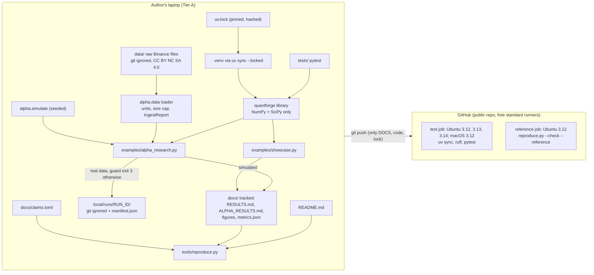

# Design

Phase 2. Date: 2026-11-19. Status: awaiting approval. Code read: origin/main at b1e33bc. Tier A: a library and two report scripts on the author's laptop, a public source repository, GitHub Actions as the only remote machine, a budget of 0 USD.

QuantForge stays separate from zft-capital (decision 0001). Nothing in this design shares code, data, tooling or configuration with it.

The rule for every decision: keep what exists unless a Phase 1 number or risk shows it fails. Each table says keep or change, and names the number or risk behind any change. The git history rewrite is not approved, and nothing in this design depends on it (R2 stays open).

## 1. Major decisions

Each has a decision note in docs/decisions. Prices and limits were checked on the dates given.

### 1.1 Language and supported Python versions (decision 0003)

| Option | Cost | Risk | Reversible | Pick when |
|---|---|---|---|---|
| Keep Python, keep 3.10 and up, test 3.10 to 3.13 (today) | None | 3.10 is past end of life since 2026-10-01. 3.10 and 3.11 jobs resolve older NumPy and SciPy than 3.12 and up, so the matrix tests different code from the one that made the published digits (R11, R23, A25 fails) | Yes | Never, on current evidence |
| Keep Python, require 3.12 and up, test 3.12, 3.13, 3.14 | One line in pyproject.toml, one in tests.yml, ruff target change | Drops 3.11 users; no outside user is known (assumption 2). Ruff `UP` rules may ask for small syntax updates when the target moves to py312 | Yes | Recommended. Latest NumPy 2.5.5 and SciPy 1.18.1 both need 3.12 or newer, and 3.12 is installed on the author's Mac |
| Keep Python, require 3.11 and up | Small | 3.11 still resolves older NumPy and SciPy, so the digits problem stays | Yes | An outside user on 3.11 appears |
| Require 3.13 and up | Small, plus a Python download on the laptop (network install, needs approval) | Nothing gained for the numbers | Yes | A library needs 3.13 |
| Rewrite in another language | Weeks | Loses the explainable NumPy code that is the project's point | Hard | Never |

Recommendation: keep Python, change the floor to 3.12. Test 3.12, 3.13 and 3.14. Add 3.15 when every locked dev package ships a wheel for it (NumPy and SciPy already do; matplotlib, scikit-learn and statsmodels not checked). The reference Python for published digits is 3.12.

Evidence: https://devguide.python.org/versions/ (checked 2026-11-19): 3.10 end of life 2026-10-01; 3.11 security until 2027-10; 3.12 security until 2028-10; 3.13 until 2029-10; 3.14 until 2030-10. PyPI JSON (checked 2026-11-19): numpy 2.5.5 `requires_python >=3.12`, first file uploaded 2026-11-15, macOS arm64 wheels for cp312 to cp315; scipy 1.18.1 `>=3.12`, uploaded 2026-08-21, macOS arm64 wheels for cp312 to cp315; matplotlib 3.11.2 `>=3.11`; scikit-learn 1.9.1 `>=3.11`; statsmodels 0.15.0 `>=3.10`; pytest 9.2.0 `>=3.10`; ruff 0.17.6 `>=3.7`.

### 1.2 Libraries and dependency groups (decision 0004)

| Option | Cost | Risk | Reversible | Pick when |
|---|---|---|---|---|
| Keep runtime NumPy and SciPy only; keep one `dev` extra holding matplotlib too (today) | None | The examples have no documented install of their own (current-state, library addendum) | Yes | Never; the gap is cheap to close |
| Keep runtime NumPy and SciPy only; split extras into `examples` (matplotlib) and `dev` (test oracles, pytest, ruff, plus matplotlib through `examples`) | Edit pyproject.toml | None found | Yes | Recommended |
| Adopt QuantLib as a pinned dev test oracle now | One dev dependency | Larger lock; nothing in Phase 1 needs it | Yes | A pricing claim lacks an independent check |
| Adopt FinancePy as a dev oracle | One dev dependency | GPL 3.0 tool in the test chain (R8) | Yes | Never without its own decision |
| Add pandas, statsmodels or scikit-learn at runtime | Adds runtime dependencies | Breaks the NumPy and SciPy only rule (assumption 8) | Yes | The author drops that rule |

Recommendation: keep NumPy and SciPy as the only runtime dependencies. Change the extras: `examples = ["matplotlib"]`, `dev` keeps pytest, ruff, scikit-learn, statsmodels and includes the `examples` extra. Every version is fixed by the lockfile (1.3), so lower bounds in pyproject.toml stay as plain compatibility floors.

### 1.3 Environment and lockfile (decision 0005, project specific)

| Option | Cost | Risk | Reversible | Pick when |
|---|---|---|---|---|
| Keep `pip install -e ".[dev]"` unpinned (today) | None | Fails R11 and the 100 percent reproducibility number: the same commit can print different digits | Yes | Never |
| pip-tools: one `requirements` file with hashes per Python version and platform | pip-tools is a new tool to install (network) | Several files to keep in step; easy to update one and not the others | Yes | uv is ruled out |
| uv with `uv.lock` (one universal lockfile across Python versions and platforms, with sha256 hashes), `uv sync --locked` locally and in CI | uv 0.13.7 is already installed on the Mac (Homebrew); CI gets it from the official setup action, pinned by commit | One more tool to learn; a single vendor's tool | Yes: `uv export` writes requirements.txt with hashes or pylock.toml (PEP 751), so pip can take over | Recommended |
| conda or a conda lock | Large new toolchain | Different binary builds from PyPI wheels; more moving parts | Yes | Never here |
| A container image | Docker on the Mac | Heavy for a library; does not cover native macOS testing | Yes | Never at Tier A |

Recommendation: change to uv with a committed `uv.lock`. Lock with a cool off window (`uv lock --exclude-newer` set about 14 days back) so a release only days old, such as numpy 2.5.5 on 2026-11-15, is not taken the day it lands (R33). Install from the network only when the author approves it in Phase 3.

Evidence: https://docs.astral.sh/uv/concepts/projects/layout/ (checked 2026-11-19) calls `uv.lock` "a universal or cross platform lockfile" that captures packages "across all possible Python markers". https://docs.astral.sh/uv/concepts/projects/sync/ (checked 2026-11-19): `--locked` raises an error when the lockfile is out of date; `uv.lock` exports to requirements.txt, pylock.toml and CycloneDX. The local `uv export --help` lists `--no-hashes`, so hashes are written by default; a uv 0.13 lockfile on the author's machine was seen to carry a sha256 `hash` for every wheel and sdist. The uv documentation pages read did not state the hash behavior themselves.

### 1.4 Data store and output layout (decision 0006)

| Option | Cost | Risk | Reversible | Pick when |
|---|---|---|---|---|
| Keep files in git; every run writes to docs/ (today) | None | Fails decision 0002: a real data run overwrites tracked docs/ALPHA_RESULTS.md and docs/figures (R1, T2, A9 fails) | Yes | Never |
| Keep files in git for simulated outputs; real data outputs and raw files go to git ignored folders; the script refuses to write real data output anywhere else | An `--out` argument, a path guard, three ignore rules, one test | A guard can be bypassed by hand copying; the guard is a seat belt, not a lock | Yes | Recommended |
| A database (SQLite or Postgres) for results | New component | Moving parts for one user and a few files; nothing in Phase 1 needs queries | Yes | Never at this scale |
| Parquet or HDF5 for raw data | New dependency (pyarrow or h5py) | Breaks the NumPy and SciPy rule | Yes | Real data volume makes CSV parsing the measured bottleneck |

Recommendation: keep files, no database. Change the output layout:

| Path | Tracked | What goes there | Written by |
|---|---|---|---|
| docs/RESULTS.md, docs/figures/*.png (non alpha) | Yes | Simulated benchmark report | showcase.py with the default output |
| docs/ALPHA_RESULTS.md, docs/figures/alpha_*.png | Yes | Simulated alpha report | alpha_research.py with no data arguments |
| docs/metrics.json | Yes, generated | Every published number as a value with its format (section 2) | both scripts |
| docs/claims.toml | Yes, hand written | Each README number tied to a metric and a tolerance | the author |
| data/ | No (ignored) | Raw Binance zips and CSVs | the author, by hand download |
| local/runs/RUN_ID/ | No (ignored) | Any real data report, figures, metrics and manifest | alpha_research.py when `--bookticker` is given |

Ignore rules added: `data/`, `local/`, `*.zip`, `*.csv` (with a negation only if a small synthetic test fixture is ever tracked; today none is). File names stay as they are; nothing tracked moves. This implements option A of decision 0002. Option B (a published CC BY NC SA folder) needs its own decision later.

### 1.5 Reproduction and drift check (decision 0007, project specific)

| Option | Cost | Risk | Reversible | Pick when |
|---|---|---|---|---|
| Keep hand typed README numbers and no check (today) | None | Fails the success outcome; R9, R31; A2 and A3 fail | Yes | Never |
| Regenerate in CI and run `git diff --exit-code` on the Markdown reports | Small | Text diff flaps on the last digit between macOS and Linux or between NumPy builds; README numbers stay unchecked | Yes | Only one platform ever regenerates |
| Generate README.md from a template | Medium | The README becomes a build output that is awkward to edit by hand | Yes | The README grows many more numbers |
| Each script writes docs/metrics.json; a hand written docs/claims.toml ties each README number to a metric, a format and a tolerance; one checker regenerates into a temporary folder and compares numbers, then checks each README string | Medium: one checker script, a metrics writer in each script | The registry itself can fall behind the README; the checker also lists README numbers that no claim covers | Yes | Recommended |

Recommendation: change to the metrics plus claims design. One documented command:

- `uv run python tools/reproduce.py` regenerates the tracked reports, figures and docs/metrics.json in place.
- `uv run python tools/reproduce.py --check` regenerates into a temporary folder, compares with the committed docs/metrics.json within each tolerance, checks every claim string appears in README.md, counts collected tests in process, and on the reference environment also requires the Markdown reports to match byte for byte.

Wall times leave every published table (the "0.9 s" at README line 44 and the "about 45 s" lines) or move to a line marked as not a claim. Figures are regenerated but not compared byte for byte, because PNG output depends on font and renderer builds; the numbers they plot are compared through metrics.json.

### 1.6 Hosting (decision 0008)

Does not apply as a service: nothing is served. What remains is where the code lives and where CI runs.

| Option | Cost | Risk | Reversible | Pick when |
|---|---|---|---|---|
| Keep GitHub repository and GitHub Actions standard runners | 0 USD for public repositories | Free terms could change (R24) | Yes; tests run locally as the fallback | Recommended |
| Publish to PyPI | Free, but the name `quantforge` is taken (assumption 7) | Moves the tier to B (R25) | Hard: a published version cannot be reused | The author approves a release under a new name |
| Host the notebook (Binder, a static site) | 0 USD on free tiers | Moves the tier to B | Yes | A reader demo becomes a goal |

Recommendation: keep. Change only the CI job layout (section 5). Evidence: https://docs.github.com/en/billing/concepts/product-billing/github-actions (checked 2026-11-19): the use of standard GitHub hosted runners is free in public repositories; larger runners are billed even for public repositories; GitHub Free includes 500 MB of artifact storage and 10 GB of cache per repository. No minute limit is stated for public repositories on that page.

### 1.7 Authentication (decision 0009)

Does not apply: no accounts, no service, no users other than the author. The only credential in play is the per run CI token. Change: add `permissions: contents: read` to the workflow (R20). The author's own GitHub sign in stays in the laptop credential store and is out of scope.

### 1.8 Background work (decision 0010)

Does not apply as a service. The only work that runs away from the keyboard is CI.

| Option | Cost | Risk | Reversible | Pick when |
|---|---|---|---|---|
| Keep CI on push and pull request only | None | A new upstream release cannot break a locked build, so a schedule adds little | Yes | Recommended now |
| Add a weekly scheduled job that tries `uv lock --upgrade` and runs the checks | Free on standard runners | Noise; belongs with the update routine | Yes | Phase 8 maintenance |
| A worker or queue for long studies | New component | Nothing in Phase 1 needs it | Yes | Never at Tier A |

Recommendation: keep push and pull request triggers, add `workflow_dispatch` for a manual rerun. The weekly lock refresh waits for Phase 8.

### 1.9 Data source (decision 0011, project specific)

| Option | Cost | Risk | Reversible | Pick when |
|---|---|---|---|---|
| Keep simulated data as the only published source; keep the Binance loader for local research, hardened | Phase 4 slices for units, size cap, validation, latency | Real data findings stay unpublished | Yes | Recommended; matches decision 0002 option A and assumption 15 |
| Publish real data results under CC BY NC SA 4.0 | A few hours per study | Two licenses in one repository; files can be withdrawn (terms 5.3) | Yes, by a later commit (history keeps it) | A new decision, after a research record exists |
| Remove the Binance loader | An hour | Loses a README feature | Yes | Terms or location rule out use (assumptions 17, 20) |
| Another free data source | Research time | New terms to read | Yes | Binance withdraws the files |

Recommendation: keep. The loader stays because nothing in Phase 1 shows it fails for simulated publication; it does fail the real data acceptance tests (A10, A11, A20), so it is hardened in Phase 4, not replaced. No new download is planned in this phase.

### 1.10 Version and release (decision 0012)

| Option | Cost | Risk | Reversible | Pick when |
|---|---|---|---|---|
| Keep 1.0.0, untagged (today) | None | Promises a stable API nobody reviewed (R28) | Yes | Never as it stands |
| Keep 1.0.0, write a changelog, tag v1.0.0 | An hour | Every later rename needs a 2.0.0 | Tags can be deleted, but a pushed tag may be fetched by others | The author reviews the public surface and commits to it |
| Reset to 0.9.0 (semantic versioning 0.y.z: public API not yet stable), changelog, tag only when the success outcome is met | An hour | A version going down can confuse; no release or tag exists, so nobody depends on 1.0.0 | Yes | Recommended |

Recommendation: change to 0.9.0. No package index release (the name is taken; tier stays A). A git tag is a push, so it waits for the author's yes in Phase 7.

## 2. Data model

### Today

- Library inputs and outputs: NumPy float64 arrays or Python floats, with units stated in docstrings (prices in currency, rates and volatilities as decimals per year, times in years; alpha signals in basis points on a step grid).
- `BookSeries` (src/quantforge/alpha/data.py lines 38 to 56): bid, ask, bid_qty, ask_qty, buy_vol, sell_vol arrays on a fixed clock grid, `tick: float`, `time_ms: ndarray | None`. `SyntheticBook` extends it with the planted drift.
- Result dataclasses: `OLSResult`, `TakerResult`, `MMResult`, `GarchParams`, `HestonParams` and others; plain fields, no versioning.
- Persisted data: Markdown reports and PNG figures under docs/; nothing else. No provenance record is written.

### Changes

| Change | Kind | Why |
|---|---|---|
| `BookSeries` gains optional `time_field: str = "transaction_time"`, `time_unit: str = "ms"`, `ingest: IngestReport | None = None` | Additive, defaults keep old callers working | A10, A11, R15 |
| New `IngestReport` dataclass: rows read, rows dropped by reason (crossed quote, nonpositive size, non monotone time, NaN), timestamp unit detected, file sha256, file size in bytes | New | Bad rows counted and set aside, not silently kept (section 9 of the master prompt) |
| New run manifest `manifest.json` beside every report: schema_version, generator, source kind (simulated or binance), seed or file names with sha256 and download date, step_ms, time_field, time_unit, latency_steps, Python minor version, uv.lock sha256 | New | Research addendum: data sources and dates recorded; R6, R14 |
| New docs/metrics.json: schema_version, generator per section, and a map from metric id to `{value, format}` | New, generated, tracked | Decision 0007 |
| New docs/claims.toml: one entry per README number with id, README text, metric id, tolerance (absolute or relative) | New, hand written | Decision 0007 |

### Migration approach

No database, so no migrations in the usual sense. Rules:

- Changes to dataclasses are additive with defaults. A field is renamed or removed only with a changelog line and a minor version bump while below 1.0.
- metrics.json and manifest.json carry `schema_version: 1`. The checker refuses an unknown version with a clear message rather than guessing.
- Old reports are not migrated; they are regenerated. That is the point of the design.
- Real data outputs written before this design (none are known, assumption 6) are not touched.

## 3. Interfaces between components

Errors follow one rule across the library: domain errors raise `ValueError` with a message naming the parameter, the value and the unit; wrong types raise `TypeError`; NaN in an input gives NaN in the matching output, never a silent zero.

### 3.1 Library public surface (F3)

- Inputs: float or array like of float, broadcastable. Outputs: float or float64 ndarray of the broadcast shape.
- Errors to add in Phase 4 (A6): negative or zero volatility where undefined, nonpositive maturity where undefined, empty arrays for risk statistics, mismatched lengths, confidence levels outside (0, 1).
- `quantforge.alpha` becomes importable from the top level and listed in `__all__`, matching the docstring.

### 3.2 Loader (F6)

```python
def read_binance_csv(path: str | Path, columns: list[str], *, max_bytes: int = DEFAULT_MAX_BYTES) -> dict[str, np.ndarray]
def load_binance(bookticker_path: str | Path, aggtrades_path: str | Path | None = None, *,
                 step_ms: int = 100, tick: float | None = None,
                 time_field: Literal["transaction_time", "event_time"] = "transaction_time",
                 time_unit: Literal["auto", "ms", "us"] = "auto",
                 max_bytes: int = DEFAULT_MAX_BYTES) -> BookSeries
```

| Case | Result |
|---|---|
| Path missing | `FileNotFoundError` |
| File or zip member above `max_bytes` (cap set after one real file is measured; A20) | `ValueError` naming the size and the cap, before reading the body |
| Zip with no member or more than one member | `ValueError` |
| Required column missing | `ValueError` listing the missing names |
| Timestamps in microseconds with `time_unit="ms"`, or in milliseconds with `"us"` | `ValueError`; with `"auto"`, the unit is detected from magnitude and recorded in `ingest` (A11) |
| Crossed quote, nonpositive size, NaN, time going backwards after sort | Row dropped and counted in `IngestReport`; if more than a stated share (default 1 percent) is dropped, `ValueError` |
| Empty file after filtering | `ValueError` |

### 3.3 Backtest

```python
def taker_backtest(forecast_bps, bid, ask, horizon: int, threshold_bps: float = 0.0,
                   fee_bps: float = 0.0, *, latency_steps: int = 0) -> TakerResult
```

`latency_steps` delays the fill: a decision at step t fills at the quote of step t plus latency. Default 0 keeps every published simulated number unchanged. The real data path passes 1 and reports 0 and 1 side by side (A10, R12). Errors: `ValueError` for negative latency, horizon below 1, or arrays of different lengths.

### 3.4 Report scripts

| Command | Writes | Exit codes |
|---|---|---|
| `python examples/showcase.py [--out DIR]` | DIR/RESULTS.md, DIR/figures/*.png, metrics into DIR/metrics.json; default DIR is docs | 0 done; 2 bad arguments |
| `python examples/alpha_research.py [--out DIR]` | DIR/ALPHA_RESULTS.md, DIR/figures/alpha_*.png, metrics; default DIR is docs | 0; 2 |
| `python examples/alpha_research.py --bookticker F [--aggtrades F] [--step-ms N] [--fee-bps X] [--latency-steps N] [--time-field NAME] [--out DIR]` | report, figures, metrics.json and manifest.json in DIR; default DIR is local/runs/RUN_ID | 0; 2; 3 when DIR resolves outside local/ (the guard for decision 0002) |

RUN_ID is the symbol, the file date and a UTC timestamp, for example `BTCUSDT_2026-11-01_20261119T1530Z`. Each script exposes `main(argv: list[str] | None = None) -> int` so the reproduce tool can import it; no subprocess is used (A29).

### 3.5 Reproduce tool

`tools/reproduce.py`, run as `uv run python tools/reproduce.py [--check] [--reference]`.

| Exit code | Meaning |
|---|---|
| 0 | Regenerated, or every check passed |
| 1 | At least one metric outside tolerance; lists metric ids, committed and new values |
| 2 | A claim's text is missing from README.md, or a README number has no claim; lists them |
| 3 | metrics.json or claims.toml is missing, unreadable or has an unknown schema_version |
| 4 | With `--reference`, a Markdown report differs byte for byte from the committed one |

`--reference` is set only in the CI reference job (Ubuntu, Python 3.12, locked).

### 3.6 CI

Inputs: the commit and `uv.lock`. Outputs: pass or fail per job. The workflow gets no secrets and a read only token.

## 4. Response time budget

Does not apply: no request path, server or interface (docs/requirements.md section 2). The stand in budgets are split across the steps that do exist. All are targets, none measured yet; Phase 3 measures them.

| Step | Budget | Parent budget |
|---|---|---|
| `uv sync --locked` in CI with a warm cache | 2 min | CI job 15 min |
| ruff | 0.5 min | CI job 15 min |
| pytest | 2 min (the 120 s suite budget) | CI job 15 min |
| showcase.py | 6 min | reproduce job 15 min, and the 10 min per script budget |
| alpha_research.py, simulated | 6 min | reproduce job 15 min, and the 10 min per script budget |
| claims check | 1 min | reproduce job 15 min |
| Fresh clone to working environment on the Mac | 30 min | recovery budget |

Tests and reproduction run as separate jobs so each fits its own 15 minutes.

## 5. Environments

| Environment | Where | Python | How it differs |
|---|---|---|---|
| Local | Author's Mac, macOS on Apple Silicon, `.venv` made by `uv sync --locked` | 3.12 (3.12.1 installed) | Can run real data studies with files in data/; outputs go to local/ |
| Test | GitHub Actions: Ubuntu with 3.12, 3.13, 3.14; one macOS job with 3.12 | as listed | No real data, no secrets, read only token |
| Reference | One CI job: Ubuntu, Python 3.12, locked, `reproduce.py --check --reference` | 3.12 | The only place byte for byte report equality is required |
| Demo or production | Does not apply (Tier A, nothing served, nothing published) | | |

Configuration differs only by command line flags. There are no environment variables, no secrets and no `.env` file, so no example environment file is needed; this is recorded so the standard file list in section 13 is not read as a gap. Runner images are named exactly (not `latest`) once the current image list is read in Phase 3.

## 6. Cost

| Scale | What it means | Monthly cost |
|---|---|---|
| Expected | One author, a few dozen pushes a month, four test jobs plus one macOS job plus one reproduce job per push; one real data day at a time on the laptop | 0 USD |
| Ten times | Ten times the pushes, or ten readers cloning and running, or ten real data days per study | 0 USD |

Standard runners in public repositories are free (GitHub billing page, checked 2026-11-19). PyPI downloads, uv and every library are free. Binance Vision files are free (Dataset Terms 2.3, checked 2026-11-17).

First limit hit: the laptop's memory on real data runs, not any GitHub limit. The loader reads a whole zip member into one string and every row into Python lists (data.py lines 64 and 67), so ten days of data in one run would likely pass the 4 GB target well before CI notices anything. Not measured; Phase 4 sets the size cap from one real file. The first GitHub limit that could bite is the 500 MB artifact storage on GitHub Free, only if CI starts uploading reports as artifacts; the design does not upload any. If the repository ever turned private, standard runner minutes would draw on the 12 USD monthly compute allowance that the same page lists.

## 7. Architecture



## 8. Walking skeleton

The thinnest path that touches every component and the real host. For Tier A the real host is GitHub Actions; nothing is deployed.

1. `uv.lock` committed; `uv sync --locked` builds `.venv` on the Mac and in CI from Python 3.12.
2. `import quantforge` and one existing test (the Black Scholes ATM call against 10.450584) pass under pytest in that environment.
3. showcase.py writes one metric, `bs.atm_call`, into docs/metrics.json next to its existing Markdown row.
4. docs/claims.toml holds one claim tying that README value to the metric with a stated tolerance.
5. `tools/reproduce.py --check` regenerates into a temporary folder and passes; editing the digit in docs/metrics.json or README.md makes it exit 1 or 2.
6. alpha_research.py given a tiny synthetic file shaped like a Binance bookTicker writes only under local/runs/, and exits 3 when pointed at docs/.
7. CI runs steps 1, 2 and 5 on Ubuntu 3.12; the run is green, and a branch with the edited digit is red.

Already in place: the src layout and package; the 80 test functions and the closed form check; ruff config; the CI workflow on push and pull request; both scripts compute every report number from seeds; `load_binance` and `book_from_events` already form the real data path; report headers already say "Generated by". What is missing: the lockfile, the output argument and guard, metrics.json, claims.toml and the checker.

## 9. What this design does not do

- No history rewrite and no plan that needs one (R2, assumption 11).
- No new pricing model, no speed work, no package index release, no hosted notebook.
- No shared code or tooling with zft-capital.
- No real data download; that waits for a research record and the author's confirmation of assumptions 17, 18 and 20.
